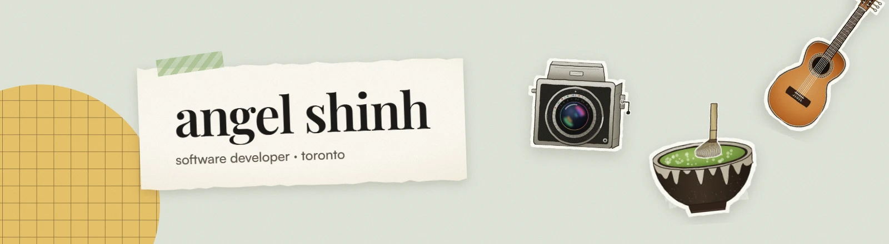

# hey, i'm angel 👋

toronto · [ashinh.lol](https://www.ashinh.lol) · [linkedin](https://linkedin.com/in/angelshinh) · [email](mailto:shinh.maverick@gmail.com)
 
 

> 🍵 drinking matcha isn't always performative (6'2" btw)

###### where i've worked
 software developer intern @ [rbc](https://www.rbc.com) · open banking apis
  technical systems analyst intern @ [rbc](https://www.rbc.com) · IAM and validation of IAM control implementation
  machine learnign intern @ [meta trading club](https://www.metatradingclub.com/) · trade algos and react chat-bots
  vp of technology @ [google developer groups](https://gdg.community.dev) · workshops for 150+ devs
  director of technology @ [cusec](https://cusec.net) · building cusec 2027 & 2026
  Ambassador @ [seneca polytechnic](https://www.senecapolytechnic.ca) · peer wellness

###### things i've built
 [pii scanner](https://www.ashinh.lol/projects/pii-scanner) · finds sins and card numbers without showing them to the model
  [adk harness](https://www.ashinh.lol/projects/adk-harness) · a policy gate for ai agents in google workspace
  [devflow](https://www.ashinh.lol/projects/devflow) · ai code review for github pull requests
  [sonatelle](https://www.ashinh.lol/projects/sonatelle) · a self-hosted notes app that can't lose a note
 [view all →](https://www.ashinh.lol/projects)

###### what i use

